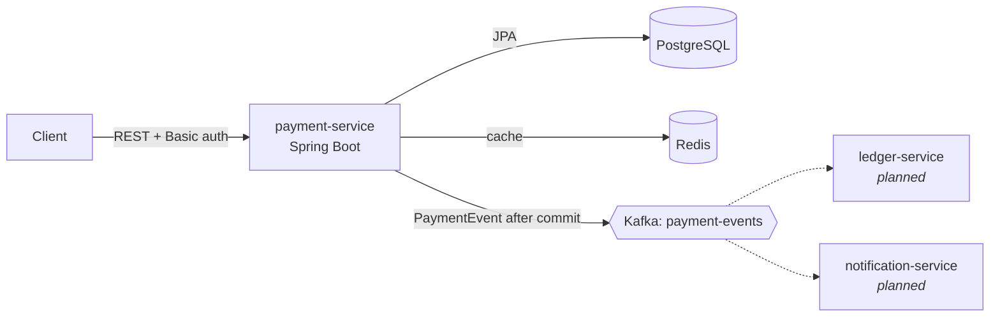

# FinOpsX — Payments Microservice Platform

[](https://github.com/MaheshMandem/Finopsx/actions/workflows/ci.yml)


A backend platform that models how banks and payment companies move money: small services that own their data, communicate through events, and are built for **correctness, idempotency and auditability**.

The first service, **payment-service**, is a working payment API.

## Features

- **Idempotent payment creation.** Every `POST` needs an `Idempotency-Key`. A client retry with the same key returns the original payment instead of paying twice; the same key with a different body is rejected with `409`.
- **Payment state machine.** `INITIATED → PROCESSING → COMPLETED / FAILED`, or `INITIATED → CANCELLED`. Illegal jumps (e.g. `INITIATED → COMPLETED`) and changes to final payments are rejected.
- **Event-driven.** Every create and status change publishes a `PaymentEvent` to Kafka **after the database transaction commits**, keyed by payment id so events for one payment stay in order.
- **Redis caching** for payment lookups, refreshed on every status change.
- **Optimistic locking** (`@Version`) so concurrent updates can't overwrite each other.
- **Money handled safely** with `BigDecimal` (19,4), ISO 4217 currency codes and request validation.
- **Secured API** with Spring Security (HTTP Basic); health endpoint stays public.
- **Consistent error responses** (`400`, `401`, `404`, `409`) from one global handler.
- **Tested** with JUnit 5, Mockito and MockMvc, and built on every push by GitHub Actions.

## Architecture



## API

| Method | Endpoint | Description |
|---|---|---|
| `POST` | `/api/v1/payments` | Create a payment (`Idempotency-Key` header required). `201` new, `200` replay |
| `GET` | `/api/v1/payments/{id}` | Get a payment (served from Redis when cached) |
| `PATCH` | `/api/v1/payments/{id}/status` | Move a payment to its next status |
| `GET` | `/actuator/health` | Health check (public) |

**Create a payment**

```bash
curl -u finopsx:change-me -X POST http://localhost:8080/api/v1/payments \
  -H "Content-Type: application/json" \
  -H "Idempotency-Key: 7f3c2a10-order-1001" \
  -d '{"debtorAccount":"ACC-1001","creditorAccount":"ACC-2002","amount":2500.00,"currency":"INR","reference":"Invoice 42"}'
```

**Move it forward**

```bash
curl -u finopsx:change-me -X PATCH http://localhost:8080/api/v1/payments/{id}/status \
  -H "Content-Type: application/json" \
  -d '{"status":"PROCESSING"}'
```

## Run locally

Prerequisites: Java 17, Maven, Docker.

```bash
git clone https://github.com/MaheshMandem/Finopsx.git
cd Finopsx/finopsx
docker compose up -d                      # PostgreSQL, Redis, Kafka
cd backend/payment-service
mvn spring-boot:run
```

Run the tests:

```bash
mvn test
```

Settings can be overridden with environment variables: `DB_URL`, `DB_USERNAME`, `DB_PASSWORD`, `REDIS_HOST`, `KAFKA_BOOTSTRAP_SERVERS`, `API_USERNAME`, `API_PASSWORD`.

## Project structure

```
finopsx/
├── docker-compose.yml
└── backend/
    └── payment-service/
        └── src/main/java/com/finopsx/payment_service/
            ├── config/       security, Redis cache, Kafka topic
            ├── domain/       Payment entity + PaymentStatus state machine
            ├── dto/          request/response records with validation
            ├── event/        PaymentEvent + after-commit Kafka publisher
            ├── exception/    domain exceptions
            ├── repository/   Spring Data JPA
            ├── service/      business logic (idempotency, transitions)
            └── web/          REST controller + global error handler
```

## Roadmap

- [x] Payment API with idempotency keys
- [x] Payment status state machine
- [x] Kafka events, Redis cache, optimistic locking
- [x] Unit and web-layer tests, CI pipeline
- [ ] Transactional outbox for guaranteed event delivery
- [ ] Flyway database migrations
- [ ] JWT / OAuth2 authentication
- [ ] Ledger service with double-entry bookkeeping
- [ ] Integration tests with Testcontainers

## Author

**Mahesh Mandem** · Java Backend Engineer, fintech · [GitHub](https://github.com/MaheshMandem)
