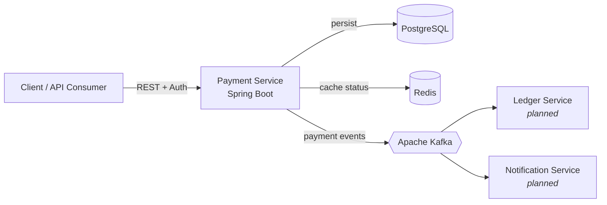

<div align="center">

# 💳 FinOpsX

### A fintech microservices platform built with Java 17, Spring Boot 3, Kafka, Redis & PostgreSQL


</div>

---

## 📌 Overview

**FinOpsX** is a hands-on project that models how banks and payment companies build backend systems: small, independent services that own their data, talk to each other through events, and are designed for **correctness, idempotency and auditability**.

The first service is the **Payment Service**. More services (ledger, notifications, accounts) will be added over time.

---

## 🏗️ Architecture



---

## 🧰 Tech Stack

| Layer | Technology |
|---|---|
| Language | Java 17 |
| Framework | Spring Boot 3.5 (Web, Data JPA, Security, Actuator) |
| Messaging | Apache Kafka (`spring-kafka`) |
| Caching | Redis (`spring-boot-starter-data-redis`) |
| Database | PostgreSQL |
| Build | Maven (wrapper included) |
| Testing | JUnit 5, Spring Boot Test, Spring Kafka Test, Spring Security Test |
| Productivity | Lombok |

---

## 📂 Project Structure

```
finopsx/
└── backend/
    ├── pom.xml                  # parent build
    └── payment-service/         # Spring Boot microservice
        ├── pom.xml
        └── src/
            ├── main/java/com/finopsx/payment_service/
            ├── main/resources/application.properties
            └── test/java/com/finopsx/payment_service/
```

---

## 🗺️ Roadmap

- [x] Bootstrap Payment Service (Spring Boot 3, Java 17)
- [x] Add dependencies for JPA, Security, Kafka, Redis, Actuator
- [ ] Payment initiation & status REST APIs
- [ ] Idempotency keys to prevent duplicate payments
- [ ] Publish `PaymentCreated` / `PaymentCompleted` events to Kafka
- [ ] Redis cache for payment status lookups
- [ ] JWT-based authentication with Spring Security
- [ ] Ledger Service (double-entry bookkeeping) consuming payment events
- [ ] Docker Compose for local setup (Postgres, Redis, Kafka)
- [ ] Integration tests with Testcontainers

---

## ▶️ Running Locally

**Prerequisites:** Java 17+, and running instances of PostgreSQL, Redis and Kafka.

```bash
git clone https://github.com/MaheshMandem/Finopsx.git
cd Finopsx/finopsx/backend/payment-service
./mvnw spring-boot:run
```

Health check (Spring Boot Actuator):

```bash
curl http://localhost:8080/actuator/health
```

---

## 👤 Author

**Mahesh Mandem** — Java Backend Engineer, Fintech

[](https://github.com/MaheshMandem)

⭐ If you find this project useful, consider giving it a star!
